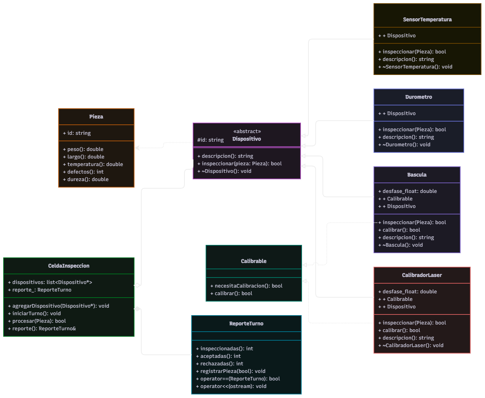

# Celda Robótica de Inspección de Calidad

Proyecto del Parcial 3 de Programación Orientada a Objetos.

La guía completa del proyecto está en [PROYECTO.md](PROYECTO.md). Léanla antes de empezar.

## 1. Equipo

| Integrante | Matrícula | Nombre | Usuario de GitHub | Clase |
| --- | --- | --- | --- | --- |
| 1 | | | | |
| 2 | | | | |
| 3 | 25176| Dannia Ximena Plata Palos| dannia-plata| SensorTemperatura|
| 4 | 25069 | Michelle González Barrera | michellegonzalez-oss | CamaraVision |
| 5 | 26011 | Alejandro Salguero Vega | alexsalguerov-stack |  |

## 2. Cómo compilar y ejecutar

Escriban el comando exacto que usa el equipo para compilar y el comando para ejecutar.

g++ -std=c++17 -Iinclude src/*.cpp -o celda_inspeccion
./celda_inspeccion

## 3. Contrato de `Dispositivo` y `Calibrable`

**¿Qué errores dio el compilador al compilar el repositorio base y qué significaba cada uno?**

El compilador em arrojaba 2 errores relacionados a los archivos Dispositivo.h y Calibrable.h ya que no coincidían con lo que el código base de CeldaInspección.cpp estaba intentando invocar.

ERROR 1: 'class calidad::Dispositivo' has no member named 'descripcion' --> El código de la celda intenta imprimir la descripción del dispositivo llamando al método d->descripcion(). Sin embargo, en la declaración de Dispositivo.h ese método no existe (o se había nombrado diferente). La clase debía definir descripcion() como método virtual puro para establecer el contrato que implementará cada sensor derivado.

ERROR 2: could not convert 'c->calidad::Calibrable::calibrar()' from 'void' to 'bool' --> CeldaInspeccion.cpp evalúa el resultado de la calibración dentro de un operador ternario (c->calibrar() ? "OK" : "FALLA"). Para que esa expresión compile, el método calibrar() de la interfaz Calibrable debe retornar un bool (true si la calibraci+on fue exitosa y false si falló), en lugar de void.

**¿Qué métodos agregaron a `Dispositivo`? ¿Cuáles son virtuales puros, cuáles son `const` y por qué el destructor es virtual?**

Métodos Virtuales Puros: 
-virtual std::string descripcion() const = 0;: Permite a la celda pedirle a cualquier dispositivo que indique qué tipo o nombre de dispositivo es.
-virtual bool inspeccionar(const Pieza& pieza) = 0;: Define la acción principal del dispositivo para evaluar una pieza y determinar si cumple con las tolerancias de calidad (retornando true o false)

Métodos 'const':
-explicit Dispositivo(const std::string& id) (Constructor): Recibe e inicializa el identificador único del dispositivo (ej. "B-01", "L-01").
-const std::string& id() const: Método de lectura de tipo const que retorna la referencia al identificador id_ del dispositivo.

Destructor Virtual:
-virtual ~Dispositivo() = default; (Destructor Virtual): Garantiza que, cuando la celda o el programa destruyan un objeto derivado a través de un puntero a la clase base (Dispositivo*), se ejecute correctamente el destructor de la clase hija y luego el de la base en orden inverso, evitando comportamientos indefinidos o fugas de memoria.

**¿Qué agregaron a `Calibrable` y por qué no tiene atributos?**

Agregaciones:
-Destructor virtual (virtual ~Calibrable() = default;): En C++, cualquier clase con métodos virtuales debe incluir un destructor virtual. Esto garantiza que si se destruye una Bascula a través de un puntero a la interfaz (Calibrable*), el compilador ejecute el destructor de la clase derivada concreta y luego el de la base, evitando fugas de memoria o comportamiento indefinido.
-virtual bool necesitaCalibracion() const = 0;: Un método virtual puro (= 0) marcado como const (porque solo consulta sin modificar el objeto) que obliga a cada derivada a reportar si requiere ajuste.
-virtual bool calibrar() = 0;: Un método virtual puro que impone el contrato para ejecutar el procedimiento de calibración y devolver true si la operación tuvo éxito.

*Calibrable no tiene atributos por 3 razones:
-Representa una Capacidad/Interfaz, no una Entidad Concreta: Calibrable no es un dispositivo físico con peso o tamaño; es la abstracción de una habilidad ("poder calibrarse"). Las interfaces puras definen únicamente el qué debe poder hacer un objeto (el contrato), dejando el cómo a cada clase derivada.
-El estado le pertenece a la clase derivada específica: Los atributos concretos de calibración (como double desfase_ en una Bascula o un CalibradorLaser) dependen exclusivamente de la naturaleza física de cada sensor. Si se colocaran atributos dentro de Calibrable, se estaría imponiendo una estructura interna rígida a cualquier clase que implemente la interfaz.
-Garantiza una Herencia Múltiple limpia sin duplicación: Clases como Bascula heredan tanto de Dispositivo como de Calibrable. Al mantener a Calibrable completamente libre de datos miembros (atributos), la herencia múltiple de interfaces no genera ambigüedades en memoria ni duplicación de atributos

## 4. Cálculo a mano del reporte

Turno de 12 piezas, con la celda ya calibrada. Escriban `ACEPTA` o `RECHAZA` por dispositivo. La columna D-01 solo la llena el equipo de seis.

| Pieza | B-01 | L-01 | V-01 | T-01 | D-01 | Resultado |
| --- | --- | --- | --- | --- | --- | --- |
| P-01 |  A | A | A | A |  | ACEPTADA |
| P-02 | A | A | A | A |  | ACEPTADA |
| P-03 | R | A | A | A |  | RECHAZADA |
| P-04 | A | A | A | A |  | ACEPTADA |
| P-05 | A | R | A | A |  | RECHAZADA |
| P-06 | A | A | R | A |  | RECHAZADA |
| P-07 | A | A | A | R |  | RECHAZADA |
| P-08 | R | R | R | A |  | RECHAZADA |
| P-09 | A | A | A | A |  | RECHAZADA |
| P-10 | A | A | A | A |  | RECHAZADA |
| P-11 | A | A | A | R |  | RECHAZADA |
| P-12 | A | A | A | A |  | ACEPTADA |

**Reporte esperado (inspeccionadas, aceptadas, rechazadas y rechazos por dispositivo):**

| Concepto | Equipo de 5 |
| :--- | :--- |
| Inspeccionadas | 12 |
| Aceptadas | 4 |
| Rechazadas | 8 |
| Rechazos B-01 | 2 |
| Rechazos L-01 | 2 |
| Rechazos T-01 | 2 |
| Rechazos V-01 | 2 |

**¿Coincide con lo que imprime el programa? Si no coincidió al primer intento, ¿qué encontraron y cómo lo corrigieron?**

El calculo no coincide con lo que imprime con el programa, pero cumple con lo que se espera que imprima según la tabla dentro de PROYECTO.md (equipo de 5 integrantes). Pendiente revisarlo.

## 5. Diagrama de clases

Diagrama de clases de la solución completa, hecho en draw.io. Guarden la imagen en la raíz del repositorio como `diseno_solucion.png`.

## 6. Documentación individual

| Integrante | Documentación de su clase | Rama del reto opcional |
| --- | --- | --- |
| Alejandro Salguero Vega | docs\docs\26011\CalibradorLaser.md |  |
| | | |
| | | |
| | | |
| Michelle González Barrera | `docs\docs\25069\CamaraVision.md` | No |
| Dannia Ximena Plata Palos|docs/docs/25176/SensorTemperatura.md| No|
|4 | `docs/<25069>/<CamaraVision>.md` | No |
| | | |

Los resultados de los experimentos están en [docs/experimentos.md](docs/experimentos.md).

## 7. Prueba de extensibilidad

Practiquen agregar un dispositivo nuevo antes de entregar.

**¿Qué archivos tuvieron que crear o modificar? ¿Tuvieron que tocar `CeldaInspeccion`?**

No tuvimos que crear algun otro archivo, únicamente modificamos: Contratos base (Calibrable.h, Dispositivo.h), Dispositivos concretos (Bascula.h y Bascula.cpp, CalibradorLaser.h y CalibradorLaser.cpp, CamaraVision.h y CamaraVision.cpp, y SensorTemperatura.h y SensorTemperatura.cpp), Reporte de Turno (RporteTuro.h y ReporteTurno.cpp), Lógica de la celda y orquestador (CeldaInspeccion.cpp y main.cpp).

## 8. Reflexión del equipo

**¿Qué aprendieron en este proyecto?**

[Inserta aquí tu respuesta]

**¿Qué cambiarían de su proceso de trabajo como equipo?**

[Inserta aquí tu respuesta]
